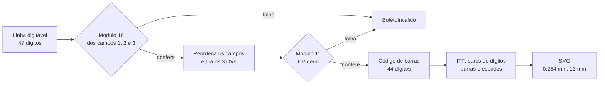

<p align="center">
  
</p>

<p align="center">
  <a href="https://github.com/Dimasaas/penny/actions/workflows/ci.yml"></a>
  
  
  
</p>

# Penny

> dinheiro em centavos inteiros, rateio exato e boleto ITF em SVG

O **Penny** guarda dinheiro em **centavos inteiros**, em Ruby puro: rateio que não perde nem cria centavo, leitura e formatação de reais, módulos 10 e 11 da FEBRABAN, conversão entre linha digitável e código de barras de boleto e o código de barras **ITF (2 de 5 intercalado)** desenhado em SVG com as medidas da norma.

## Por que existe

Float não representa dinheiro. Ele erra o centavo e, pior, erra em silêncio:

```ruby
0.1 + 0.2                  # => 0.30000000000000004
0.1 + 0.2 == 0.3           # => false
```

O mesmo vale para dividir. R$ 100,00 em 3 partes iguais não dá 3 vezes R$ 33,33 (sobra um centavo no ar), e arredondar cada parte sem cuidado faz dinheiro sumir ou aparecer:

```ruby
(100.0 / 3).round(2) * 3   # => 99.99  (um centavo sumiu)
Penny.rateio(10_000, [1, 1, 1])
# => [3334, 3333, 3333]    (soma 10000, sempre)
```

A biblioteca guarda tudo em centavos (`Integer`) e reparte pelo **método dos maiores restos**: cada parte leva o piso da sua cota exata e os centavos que sobraram vão, um a um, para quem mais perdeu na divisão. A soma das partes é sempre o total.

## Instalação

Sem dependências de runtime. Por enquanto, direto do Git:

```ruby
gem "penny", github: "Dimasaas/penny"
```

Requer Ruby 3.2 ou superior.

## Uso

### Rateio

```ruby
require "penny"

Penny.rateio(10_000, [1, 1, 1])        # => [3334, 3333, 3333]
Penny.rateio(10_000, [3, 2])           # => [6000, 4000]
Penny.rateio(101, [1, 2, 2])           # => [20, 41, 40]
Penny.rateio(-10_000, [1, 1, 1])       # => [-3334, -3333, -3333]

# percentuais precisam somar exatamente 100%
Penny.rateio_percentual(10_000, ["33,34", "33,33", "33,33"]) # => [3334, 3333, 3333]
Penny.rateio_percentual(10_000, ["33,33", "33,33", "33,33"])
# Penny::RateioInvalido: os percentuais somam 99,99%, e precisam somar 100%
```

Pesos podem ser `Integer`, `Rational`, `BigDecimal` ou texto (`"33,33"`). `Float` é recusado de propósito.

### Formatar e ler reais

```ruby
Penny.formatar(12_345)                  # => "R$ 123,45"
Penny.formatar(-5)                      # => "-R$ 0,05"
Penny.formatar(123_456, simbolo: false) # => "1.234,56"

Penny.ler("R$ 1.234,56")                # => 123456
Penny.ler("1234")                       # => 123400   (sem vírgula são reais)
Penny.ler("-R$ 5,00")                   # => -500
Penny.ler("1,234")                      # Penny::ValorInvalido
```

### Boleto

```ruby
boleto = Penny.boleto("99990.12348 56789.012343 56789.012343 3 16770000123456")

boleto.barras           # => "99993167700001234560123456789012345678901234"
boleto.valor_centavos   # => 123456
boleto.vencimento       # => 2026-12-31
boleto.linha_formatada  # => "99990.12348 56789.012343 56789.012343 3 16770000123456"

Penny.boleto("99990.12348 56789.012343 56789.012343 3 16770000123457")
# Penny::BoletoInvalido: DV geral do código de barras não confere ...
```

A leitura aceita a linha (47 dígitos) ou as barras (44), com ou sem pontuação, e recusa dizendo qual DV falhou.

Para gerar boletos **fictícios** com DVs válidos (exemplos e testes):

```ruby
Penny::Boleto.montar(banco: 999, valor_centavos: 123_456,
                        vencimento: Date.new(2026, 12, 31),
                        campo_livre: "0123456789012345678901234")
```

### Código de barras em SVG

```ruby
File.write("barras.svg", Penny.codigo_de_barras_svg(boleto.linha))
```

O SVG abaixo foi gerado por [`exemplos/gerar_svg.rb`](exemplos/gerar_svg.rb) a partir de um boleto fictício:

<p align="center">
  
</p>

## Da linha digitável ao código de barras



Posições do código de barras: banco (3), moeda (1), DV geral (1), fator de vencimento (4), valor em centavos (10) e campo livre (25). O fator conta dias desde 07/10/1997 e recomeça em 1000 depois de 9999, então o mesmo fator serve a duas datas separadas por 9000 dias; `vencimento` escolhe a mais próxima de hoje.

## Decisões

- **Penny inteiros, `Float` proibido.** Quem passa `Float` ao rateio recebe erro. O erro de arredondamento não pode entrar por acaso.
- **Maiores restos, empate para o primeiro.** É determinístico: a mesma entrada dá sempre a mesma saída, e a ordem da lista tem significado.
- **Racionais por dentro.** As cotas são calculadas com `Rational`, sem arredondar nada até a distribuição final.
- **Recusar é melhor que adivinhar.** Percentuais que não somam 100%, `"1,234"` como valor e DV errado levantam erro com mensagem clara em vez de seguir adiante.
- **Sem dependências.** Só a biblioteca padrão do Ruby; o SVG é texto montado à mão.
- **Testes sem boleto real.** Todas as linhas digitáveis dos testes são fictícias, geradas pela própria biblioteca (banco `999`, que não existe).
- **Escopo: cobrança bancária.** Boletos de arrecadação (contas de consumo, que começam com 8) ficam de fora por ora.

## Testes

```sh
bundle install
bundle exec rake test       # ou apenas: rake test
rake exemplo                # regera docs/codigo-de-barras.svg
```

## Licença

[PolyForm Noncommercial 1.0.0](LICENSE). Uso livre para estudo, pesquisa e projetos pessoais ou sem fins comerciais. Uso comercial só com autorização do autor.

## 🇺🇸 TL;DR

Ruby library that keeps money as integer cents: allocation by largest remainder (no cent is ever lost, percentages must sum to 100%), BRL parsing and formatting, FEBRABAN modulo 10/11 checksums, Brazilian bank-slip digitable line to barcode conversion with checksum validation, and ITF (interleaved 2 of 5) barcodes rendered as SVG at the official dimensions. Zero runtime dependencies, Ruby 3.2+. Source-available under PolyForm Noncommercial 1.0.0: free for study and non-commercial use, commercial use needs the author's permission.
